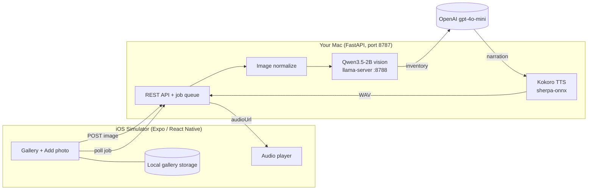

# SceneSpeak: Architecture

## 1. Overview

SceneSpeak turns a photo into a spoken description. It is built for blind and low-vision users. The user adds a photo with the **+** button. A Mac-hosted backend describes the image, writes a faithful narration, and synthesizes speech. The gallery then plays each scene like a music track.

## 2. System diagram



## 3. Pipeline

| Step | Component | Input | Output | Typical time |
|---|---|---|---|---|
| 1 | Image normalize (Pillow, pillow-heif) | Uploaded photo (HEIC/JPEG) | RGB JPEG, EXIF-rotated, max side 1280 px | under 1 s |
| 2 | Qwen3.5-2B vision (Q4_K_M GGUF + `mmproj-F16`) via llama.cpp | JPEG | Labelled inventory of the scene | 6-14 s |
| 3 | OpenAI `gpt-4o-mini` (fallback `gpt-4.1-mini`) | Inventory | 90-170 word narration | 3 s |
| 4 | Kokoro multi-lang v1.0 via sherpa-onnx (speaker 3, 24 kHz) | Narration text | WAV file | 2-6 s |

The whole run takes about 30 s per photo on a 16 GB MacBook Air.

### Why two models
- The small local vision model **observes**. It lists objects, colors, positions, people, animals, insects, clothing, actions and visible text. It does not write prose.
- The language model **writes**. It turns the inventory into fluent narration and may not add facts.
- Splitting the roles reduces hallucination and keeps the narration consistent.

### Inventory format (Qwen output)
Seven labelled lines: Setting, Main subject, Objects, People, Animals and insects, Text and signs, Background. Positions are given per item, sizes are relative, and nothing is measured or guessed.

## 4. Backend API

| Method | Path | Purpose |
|---|---|---|
| GET | `/health` | Status and queue length |
| POST | `/v1/scenes/process` | Multipart `image` (max 25 MB), returns `{jobId}` |
| GET | `/v1/jobs/{id}` | `{stage, progress, caption, sceneContext, story, audioUrl, error}` |
| GET | `/v1/jobs/{id}/audio` | WAV audio |

Job stages and progress: queued 5, qwen 15, openai 60, tts 78, done 100, error 100.

Design choices:
- One worker thread and a queue, so jobs run one at a time. This protects memory on the laptop.
- The app polls for status. This is simple and robust.
- `llama-server` is started on demand and stopped on shutdown by the API lifespan hook.
- Jobs expire after 1 hour.
- Failures return a clear message (missing key, auth, rate limit, connection, vision error).

## 5. Mobile app

- Expo SDK 58, React Native 0.88, TypeScript, Expo Router (routes in `src/app/`).
- Runs in the **Xcode iOS Simulator**. A physical iPhone is out of scope for this project.
- Reanimated 4 for calm animations. Dark, modern theme with a logo and a soft ambient background.
- Audio playback uses `expo-audio`. Photos come from `expo-image-picker`. Files are stored with `expo-file-system`.
- Uploads use `expo/fetch` with an `expo-file-system` `File`. The plain React Native `FormData` file object is not supported in SDK 58.

### Screens and routes
| Route | File | Purpose |
|---|---|---|
| `/` | `src/app/index.tsx` | Redirects to `/login` or `/gallery` |
| `/login` | `src/app/login.tsx` | Static login: `admin@gmail.com` / `admin` (temporary) |
| `/gallery` | `src/app/(main)/gallery.tsx` | Gallery, + button, processing overlay, sign out |
| `/scene/[id]` | `src/app/(main)/scene/[id].tsx` | Player with play/pause, 10 s skip and the story text |

The `(main)` group is guarded by `src/contexts/auth-context.tsx`. The session is kept in memory only.

### Data flow in the app
1. `pick-image.ts` returns a photo URI from the library or camera.
2. `process-scene.ts` uploads it (`scene-api.ts`), polls the job, then downloads the WAV into `Paths.document/scenes`.
3. Only after every step succeeds, `use-gallery.ts` saves the scene (image, audio, caption, story) in AsyncStorage. **A failed generation is never added to the gallery.**

## 6. Networking

- The Simulator shares the Mac's network, so the app calls `http://127.0.0.1:8787`.
- Use `127.0.0.1`, not `localhost`. On the Simulator `localhost` resolves to IPv6 first, and the server listens on IPv4 only, so the connection is refused.
- iOS allows plain HTTP to local addresses through `NSAllowsLocalNetworking`, which Expo enables by default.
- The URL is `EXPO_PUBLIC_SCENE_API_URL`, written to the root `.env` by `scripts/setup.sh`. It is baked in at bundle time, so changing it needs a rebuild.

## 7. Configuration

`server/.env` (git-ignored; template in `server/.env.example`):
- `OPENAI_API_KEY`
- `OPENAI_MODEL` (default `gpt-4o-mini`)
- `SCENE_SPEAK_PORT` (default 8787)

Models in `models/`: `Qwen3.5-2B-Q4_K_M.gguf`, `mmproj-F16.gguf`, `kokoro-multi-lang-v1_0/`.

Setup and run: `./scripts/setup.sh` (first time) and `./scripts/run.sh` (afterwards). Backend only: `npm run server`.

## 8. Repository layout

```
src/            Expo app (app routes, components, contexts, hooks, lib)
server/         FastAPI backend
  app.py        endpoints, queue, worker
  config.py     paths, ports, env
  pipeline/     image_normalize, qwen, openai_story, kokoro_tts
models/         local model files, downloaded by setup (not in git)
scripts/        setup.sh (one-time setup) and run.sh (start everything)
docs/           this documentation
```

## 9. Privacy and security

- Image understanding and speech synthesis run locally on the Mac.
- Only the text inventory goes to OpenAI. The photo itself never leaves the Mac.
- The API key lives only in `server/.env`. Never commit it. Rotate any key that was shared.
- The app login is a static test login. The server itself has no authentication, so run it only on your own Mac.

## 10. Limitations and future work

- The 2B vision model can miss small details. A 4B or 9B model sees more but was too slow on 16 GB.
- The backend must run on the same Mac as the Simulator. A hosted or on-device deployment would remove this.
- Possible additions: multiple languages and voices (Kokoro supports them), follow-up questions about a photo, real user accounts, a hosted backend with auth, a physical-device build, and automated tests.
